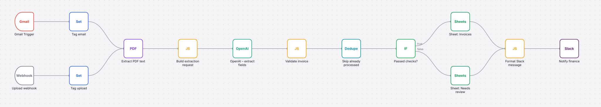

# n8n Invoice Automation

n8n workflows that pick up supplier invoices from email or upload, extract the fields with OpenAI, check the numbers, and log them to Google Sheets with a Slack notification. They're built for Saudi Arabia (15% VAT, ZATCA-style VAT numbers, dd/mm dates), but the rules are easy to change.



## Workflows

| File | Trigger | What it does |
|---|---|---|
| [`invoice-intake.json`](workflows/invoice-intake.json) | Gmail (every 5 min) or `POST /webhook/invoice-upload` | PDF → text → OpenAI JSON extraction → validation → dedupe → **Invoices** or **Needs review** sheet → Slack |
| [`invoices-due-soon.json`](workflows/invoices-due-soon.json) | Sun–Thu 08:00 (Riyadh) | Reads the Invoices sheet and posts overdue and due-in-3-days invoices to Slack |
| [`error-handler.json`](workflows/error-handler.json) | Error Trigger | Posts the failed workflow, node, message and execution link to `#automation-alerts` |

### Validation rules (`code/validate_invoice.js`)

The model's output is never trusted on its own. Before anything reaches the Invoices sheet, the workflow checks:

- vendor, invoice number, total and invoice date are present
- subtotal + VAT = total (±0.05)
- for SAR invoices, VAT = 15% of the subtotal, and the vendor VAT number matches the 15-digit `3…3` format
- line items add up to the subtotal
- the due date isn't before the invoice date
- the model's own confidence is ≥ 0.7
- amounts like `"SAR 1,500"` and dates like `05/10/2026` are normalised

Anything that fails goes to **Needs review** with the reasons spelled out, e.g. `VAT is not 15% of subtotal; line items add up to 2100.00, subtotal says 2400.00`.

Duplicates (the same vendor and invoice number sent twice) are dropped by the Remove Duplicates node. The Invoices sheet also uses append-or-update on `key`, so a re-run never creates a second row.

## Setup

1. In n8n: **Workflows → Import from file** for each JSON in `workflows/`.
2. Create credentials and select them on the nodes: **Gmail OAuth2**, **OpenAI** (used by the HTTP Request node), **Google Sheets OAuth2**, **Slack**. The exports deliberately contain no credentials.
3. Create a Google Sheet with two tabs, `Invoices` and `Needs review`. Add these headers to the first row of both:
   `key, status, issues, vendor, vendor_vat_number, invoice_number, invoice_date, due_date, currency, subtotal, vat_amount, total, line_items, source, from, file_name, received_at, paid_at`
   Then put the sheet URL into the three Google Sheets nodes (replace `YOUR_SHEET_ID`).
4. In **Settings** of the intake and digest workflows, set **Error workflow** to *Error handler – Slack alert*.
5. Test with the sample invoice:

```bash
curl -F "file=@samples/sample-invoice.pdf" -F "uploaded_by=usman" \
     https://<your-n8n>/webhook-test/invoice-upload
```

Cost: one `gpt-4o-mini` call per invoice. Input is capped at 12k characters, so it's well under a cent each.

## Code nodes are real files

The JavaScript inside the Code nodes lives in [`code/`](code/) and is copied into the workflow JSON by `scripts/build_workflows.py`. That means the logic has proper unit tests instead of being edited inside a JSON string:

```bash
npm test          # 29 tests: validation rules, prompt builder, Slack formatting, digest, workflow structure
npm run build     # regenerate workflows/*.json after editing code/
python scripts/render_diagram.py   # redraw docs/*.svg from the JSON
```

`tests/workflows.test.js` also checks every export: node types and versions, every connection points at a real node, nothing is left unconnected, the Code nodes match `code/`, and no credentials or API keys were exported by accident.

## Folder layout

```
workflows/   importable n8n JSON (generated – edit code/ and scripts/build_workflows.py instead)
code/        Code-node JavaScript
tests/       node:test suites + a tiny harness that fakes $json / $input / $()
samples/     example model outputs and a fictional invoice PDF
scripts/     build, diagram and sample generators
```

## What I'd add for production

- Arabic-only invoices: the prompt handles them, but I'd add a few real samples to the tests.
- Write the approved rows to the accounting system (Zoho Books, Odoo or QuickBooks have n8n nodes) instead of only to Sheets.
- A "mark as paid" Slack button that fills `paid_at`.

---

Built by [Usman Saleem Bhatti](https://www.upwork.com/freelancers/~017ac7683856df4451). Vendors and invoices in the samples are fictional.
